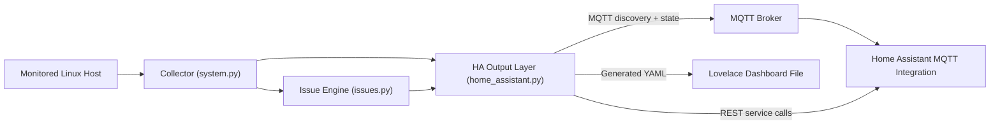

# MQTT Monitor v2 Architecture

## Purpose

Version 2 keeps the single-host focus of `mqtt-monitor`, but changes the internal shape of the system so the output is more useful in Home Assistant.

The key shift is:

- V1 mostly published raw metrics and flags
- V2 models the machine as resources plus issues

That lets one runtime feed:

- MQTT discovery
- retained state topics
- Home Assistant notifications
- a generated dashboard file

## High-Level Flow

## Runtime Modules

### Entry point

The packaged executable remains [`src/mqtt_monitor.py`](../src/mqtt_monitor.py).

It is now a compatibility shim that:

- preserves the historical executable path
- exposes the legacy helper names used by tests
- imports the real runtime from `mqtt_monitor_v2`

### Config loader

[`src/mqtt_monitor_v2/config.py`](../src/mqtt_monitor_v2/config.py) loads `/etc/mqtt-monitor/mqtt-monitor.conf`.

It supports both the older V1 options and the newer V2 options for:

- discovery
- Home Assistant notifications
- generated dashboard output
- persisted runtime state

### Data model

[`src/mqtt_monitor_v2/models.py`](../src/mqtt_monitor_v2/models.py) defines the internal resource model:

- `HostMetrics`
- `FilesystemMetric`
- `DiskMetric`
- `RaidMetric`
- `ContainerMetric`
- `Issue`
- `MonitorSnapshot`
- `MonitorState`

This is the main architectural upgrade. The rest of the code works on typed snapshots and issues rather than directly mixing MQTT topics with collection logic.

### Collector

[`src/mqtt_monitor_v2/system.py`](../src/mqtt_monitor_v2/system.py) is responsible for local system access.

It:

- reads RAID state from `/proc/mdstat`
- reads SMART and NVMe data through `smartctl`
- reads disk capacity through `blockdev`
- reads host metrics through `psutil`
- computes delta-based disk I/O rates
- discovers disks from `/sys/block`
- discovers mount points from `psutil.disk_partitions`
- discovers LXC containers through `lxc-ls`

It returns a `MonitorSnapshot` for each loop.

### Issue engine

[`src/mqtt_monitor_v2/issues.py`](../src/mqtt_monitor_v2/issues.py) evaluates the snapshot into first-class issues.

Current issue families:

- filesystem high and critical usage
- RAID degraded
- disk unavailable
- SMART failure and SMART warning flags
- disk temperature warning and critical
- `md1` write spikes
- CPU temperature warning and critical
- expected or autostart LXC container stopped

It also persists issue state under `state_dir` so the runtime can detect:

- newly active issues
- newly resolved issues

That prevents “every loop is a new alert” behavior after restarts.

### Home Assistant output layer

[`src/mqtt_monitor_v2/home_assistant.py`](../src/mqtt_monitor_v2/home_assistant.py) turns snapshots and issues into user-facing outputs.

It handles:

- MQTT discovery payloads
- retained state topics
- issue summary entities
- per-issue binary sensors
- per-container entities
- dashboard YAML generation
- optional REST service calls to Home Assistant for notifications

### Runtime loop

[`src/mqtt_monitor_v2/engine.py`](../src/mqtt_monitor_v2/engine.py) coordinates the loop:

1. load config
2. load persisted issue state
3. connect to MQTT
4. collect a snapshot
5. learn expected containers from autostart or previously running LXC containers
6. evaluate issues
7. apply issue transitions
8. publish discovery and state
9. write the dashboard YAML file
10. send Home Assistant notifications if configured

## Resource Model

### Host

Published metrics:

- CPU load percentage
- memory used megabytes
- CPU temperature celsius

### Filesystem

Each filesystem resource includes:

- mount point
- usage percentage
- free space string

The mount point is normalized into a stable slug such as:

- `/` -> `root`
- `/var/log` -> `var_log`

### Disk

Each disk resource includes:

- identity and capacity
- SMART health values
- SMART exit-code flags
- calculated I/O rates
- busy time percentage

Logical `/dev/md*` devices are allowed for capacity and I/O visibility, even though they do not expose regular SMART attributes.

### RAID array

Each RAID resource includes:

- array name
- status
- failed devices list
- raw mdstat summary

### Container

Each container resource includes:

- name
- status
- autostart flag

That lets V2 expose container state in HA and raise issues when containers expected to be up are stopped.

## Issue Model

Every issue has:

- a stable key
- title and description
- severity
- resource type and resource name
- active state
- started timestamp
- resolved timestamp

That model is what makes notifications, dashboard summaries, and future suppression or deduping features possible.

## MQTT And Home Assistant Model

V2 still uses MQTT discovery under `homeassistant/...`, but now publishes additional families beyond V1:

- issue summary sensors
- per-issue binary sensors
- container sensors
- richer disk attributes

The dashboard generator intentionally uses predictable entity IDs based on `object_id`, for example:

- `sensor.server_cpu_load_percentage`
- `sensor.server_active_issue_count`
- `binary_sensor.server_container_web_running`
- `sensor.disk_sda_capacity_gib`
- `sensor.raid_md0_status`

## Persistence

V2 writes state under `state_dir`, which defaults to `/var/lib/mqtt-monitor`.

Persisted data currently includes:

- issue transition state

The same directory is also the default destination for the generated dashboard file.

## Packaging

The Debian package now installs:

- the compatibility entrypoint in `/usr/bin/mqtt_monitor.py`
- the V2 package directory in `/usr/share/mqtt-monitor/mqtt_monitor_v2`
- the config template in `/usr/share/mqtt-monitor/mqtt-monitor.conf`

The post-install step also creates `/var/lib/mqtt-monitor` with ownership for the `mqtt-monitor` service user.

## Why This Architecture Matters

The point of V2 is not just cleaner code. The user-visible wins are:

- less manual setup through discovery
- one dashboard file instead of hand-built views
- actionable issue state instead of raw sensor hunting
- notification hooks for new and resolved problems
- container awareness in addition to storage and host health
