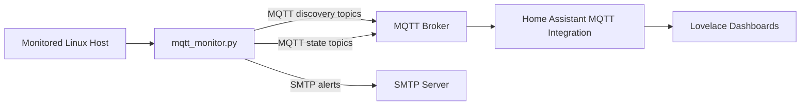

# MQTT Monitor v1 Architecture

## Purpose

`mqtt-monitor` is a single-host monitoring agent for Linux servers that:

- collects host, disk, and RAID health data locally
- publishes metrics to MQTT
- registers Home Assistant entities through MQTT discovery
- optionally sends email alerts for severe conditions

Version 1 is intentionally simple. It is a Python script packaged as a Debian package and run by `systemd` on the monitored host.

## High-Level Flow

## Main Components

### Monitored host

The monitored host is the machine where the Debian package is installed.

It provides the raw data sources:

- `smartctl` for SMART and NVMe health data
- `/proc/mdstat` for Linux software RAID state
- `psutil` for CPU, memory, disk usage, and disk I/O counters
- `blockdev --getsize64` for disk capacity
- `/sys/class/thermal/...` for CPU temperature

### Collector process

The runtime entry point is [`src/mqtt_monitor.py`](../src/mqtt_monitor.py).

Responsibilities:

- load configuration from `/etc/mqtt-monitor/mqtt-monitor.conf`
- connect to MQTT
- publish MQTT discovery payloads for Home Assistant
- poll system state on a loop
- compute delta-based I/O metrics
- publish retained MQTT state payloads
- send email alerts for configured severe conditions

### Systemd service

The packaged service definition lives at [`debian/mqtt-monitor.service`](../debian/mqtt-monitor.service).

Important runtime properties:

- runs as `User=mqtt-monitor`
- runs with `Group=disk`
- keeps `CAP_SYS_ADMIN` and `CAP_SYS_RAWIO`

Those capabilities are needed so the dedicated service user can read NVMe SMART data without running the whole service as `root`.

### MQTT broker

The broker is not bundled with this project. `mqtt-monitor` assumes a reachable broker and publishes:

- Home Assistant discovery payloads under `homeassistant/...`
- state payloads under the configured `topic_prefix`

### Home Assistant

Home Assistant consumes the discovery payloads and creates entities automatically through its MQTT integration.

This means:

- manual YAML sensor definitions are not required for the core entities
- dashboards can be built directly from discovered entities
- entity naming is stable on a clean install because `unique_id` values are stable

## Runtime Loop

At startup:

1. Load config.
2. Set up logging.
3. Connect to MQTT.
4. Optionally self-update if `package_version = latest` and a newer GitHub release exists.
5. Publish Home Assistant MQTT discovery payloads.

Each monitoring loop then:

1. Publishes host CPU, memory, and temperature metrics.
2. Reads per-disk I/O counters from `psutil`.
3. Computes delta-based rates from the previous sample.
4. Reads RAID state from `/proc/mdstat`.
5. Reads filesystem usage for configured mount points.
6. Refreshes SMART data on `smart_interval`.
7. Publishes all state back to MQTT.
8. Sends alerts when configured thresholds are crossed.

## Data Model

### Host metrics

These are always published once per loop:

| Metric | State topic suffix | HA entity example |
| --- | --- | --- |
| CPU load percentage | `host/cpu_load_percentage` | `sensor.server_monitor_server_cpu_load_percentage` |
| Memory used MB | `host/memory_used_megabytes` | `sensor.server_monitor_server_memory_used_megabytes` |
| CPU temperature C | `host/cpu_temperature_celsius` | `sensor.server_monitor_server_cpu_temperature_celsius` |
| Mount usage percentage | `host/<mount>_disk_usage_percentage` | `sensor.server_monitor_server_root_disk_usage_percentage` |

Mount names are normalized by:

- stripping the leading slash
- replacing `/` with `_`
- using `root` for `/`

### Disk metrics

For each configured device in `devices`, the collector publishes:

| Category | Topics |
| --- | --- |
| Availability | `disk/<device>/availability` |
| SMART state | `disk/<device>/smart_health_status`, `max_temperature`, `reallocated_sectors`, `spin_up_count` |
| SMART flags | `disk/<device>/command_line_parse_error`, `device_open_failed`, `smart_command_failed`, `disk_failing`, `prefail_attributes_threshold`, `past_attributes_threshold`, `device_error_log_errors`, `self_test_log_errors` |
| I/O rates | `disk/<device>/read_kilobytes_per_second`, `write_kilobytes_per_second`, `read_count_per_second`, `write_count_per_second`, `busy_time_percentage` |

Notes:

- disk I/O is delta-based, not cumulative
- the first loop after start primes counters instead of publishing bogus spikes
- `busy_time_percentage` is also delta-based and clamped to `100`
- `/dev/md1` is treated as a special logical device with usage and I/O, but not real SMART data

### RAID metrics

For each configured or discovered RAID array:

| Metric | State topic suffix | Attributes |
| --- | --- | --- |
| RAID status | `raid/<array>/status` | `failed_devices` list on `raid/<array>/attributes` |

Current status values:

- `active`
- `degraded`
- `unknown`

## MQTT Discovery Model

Discovery is published under `homeassistant/...` with retained payloads.

Entity families:

- host sensors
- mount usage sensors
- disk sensors
- disk binary sensors
- RAID sensors

Stable `unique_id` patterns:

- `server_monitor_server_<metric>`
- `server_monitor_disk_<device>_<metric>`
- `server_monitor_raid_<array>_status`

Example:

- discovery topic: `homeassistant/sensor/disk_sda_max_temperature/config`
- state topic: `<topic_prefix>/disk/sda/max_temperature`
- resulting Home Assistant entity on a clean install: `sensor.server_monitor_disk_sda_max_temperature`

If Home Assistant already has stale entities occupying those names, Home Assistant may create suffixed entity IDs such as `_2`. That is a Home Assistant registry behavior, not a different discovery schema.

## Configuration Surface

The packaged config template lives at [`src/mqtt-monitor.conf`](../src/mqtt-monitor.conf).

The main sections are:

### `[monitor]`

- alerting behavior
- log level
- whether disk I/O metrics are published
- desired package version

### `[mqtt]`

- broker host and port
- MQTT credentials
- `self_name` identifier

### `[internals]`

- `topic_prefix`
- monitored device list
- monitored RAID arrays
- SMART interval
- loop timing
- thresholds for alerts

## Packaging And Release Model

The project is released as a Debian package.

Important files:

- package metadata: [`debian/control`](../debian/control)
- package changelog: [`debian/changelog`](../debian/changelog)
- release workflow: [release.yml](../.github/workflows/release.yml)

Release process:

1. merge code to `master`
2. create a Git tag like `v1.0.1-2`
3. GitHub Actions builds `mqtt-monitor_<version>.deb`
4. the workflow creates a GitHub release and uploads the `.deb`

When `package_version = latest`, the agent checks GitHub Releases and can self-install the latest published package.

## Security Model

Version 1 intentionally avoids running the service as full root during normal operation.

Current model:

- service user: `mqtt-monitor`
- primary device access: `disk` group
- extra capabilities: `CAP_SYS_ADMIN`, `CAP_SYS_RAWIO`

This is a compromise:

- safer than running the full service as `root`
- still privileged enough to access NVMe SMART admin commands

Credentials stored locally:

- MQTT username/password
- SMTP username/password

Those credentials live in `/etc/mqtt-monitor/mqtt-monitor.conf`, so host file permissions matter.

## Alerting Model

Version 1 alerting is email-only.

Alerts are sent for:

- disk SMART failure
- RAID degradation
- mount usage above threshold
- configured write spikes on `md1`
- log directory exhaustion

Home Assistant notifications are not part of v1 itself; Home Assistant can consume the MQTT entities and build automations on top.

## Known Limits Of V1

These limits are intentional context for V2 planning:

- static device and mount lists configured by hand
- one monitored host per service instance and topic prefix
- no first-class multi-host inventory model
- no native Home Assistant dashboard generation
- no native Home Assistant notification integration
- no automatic cleanup of stale MQTT discovery entities after schema changes
- alert policy is simple and mostly threshold-based

## Related Docs

- setup: [setup.md](setup.md)
- Home Assistant integration: [home-assistant.md](home-assistant.md)
- troubleshooting: [troubleshooting.md](troubleshooting.md)
